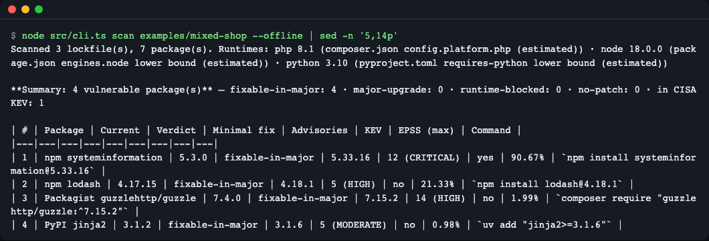
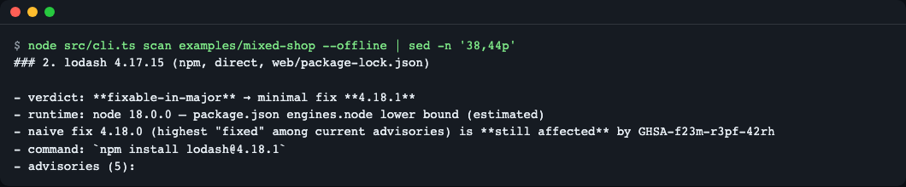
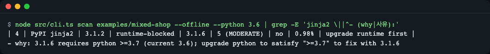
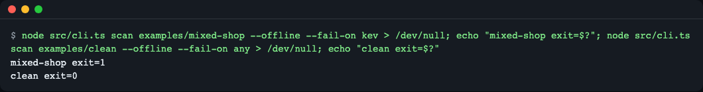
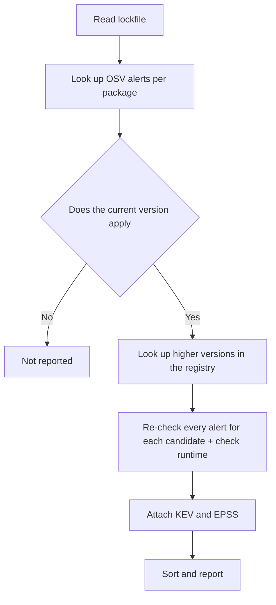

# fixplan

**English** | [한국어](README.ko.md)

fixplan turns vulnerability alerts into a fix plan: for each vulnerable package it computes the minimal upgrade that clears *every* known advisory, checks it against your PHP / Node / Python runtime, and ranks the work by CISA KEV and EPSS. Following only the "fixed version" named in one alert can leave other alerts open or break your runtime, so fixplan does that calculation for you. It reads `composer.lock`, `package-lock.json`, `uv.lock` and `requirements.txt` (M1: Composer, PyPI, npm; Maven is planned for M2). Try it with no network: `npx github:LeeGyeongPil/fixplan scan <path> --offline` (practice data recorded 2026-11-10); live mode has not been verified end to end yet.

## Result preview


*The result of scanning the example project with practice data (`--offline`). From the top down is the order to fix first.*

> All examples are based on `--offline` practice data (recorded 2026-11-10). They are not current, real alerts. The live mode that calls the real APIs has only been implemented and tested for request shape; external hosts are blocked in the development environment, so it could not be run end to end. If you are new to it, run it once yourself and be skeptical of the results.

## Who it's for
- You have dozens of dependency alerts piled up and cannot decide what to fix first
- You hit "I upgraded to the fixed version and another alert appeared" or "I want to upgrade but my PHP or Node version does not match"
- You use PHP (Composer), Node (npm) and Python (PyPI) together in one repository or monorepo

## Installation
```bash
# Prerequisites: Node.js 24.10.0 or later (e.g. https://nodejs.org or nvm install 24), git
npx github:LeeGyeongPil/fixplan scan . --offline     # Run without installing
npm install -g github:LeeGyeongPil/fixplan           # Global install (the repo contains a built dist/, so no build step is needed)
```
It has not been published to the npm registry yet. To run from source:
```bash
git clone https://github.com/LeeGyeongPil/fixplan && cd fixplan && npm ci
node src/cli.ts scan examples/mixed-shop --offline
```
On a minimal Linux image you only need `git` and Node 24.10.0 or later. There are three runtime dependencies, `semver`, `@renovatebot/pep440` and `smol-toml`, and no API key is needed.

## Quick start
```bash
npm start     # = node src/cli.ts scan examples/mixed-shop --offline
```
```
# fixplan report — examples/mixed-shop

> **offline snapshot recorded 2026-11-10 — practice data, not current advisories.** Practice mode (bundled data). Run without `--offline` for live results.

Scanned 3 lockfile(s), 7 package(s). Runtimes: php 8.1 (composer.json config.platform.php (estimated)) · node 18.0.0 (package.json engines.node lower bound (estimated)) · python 3.10 (pyproject.toml requires-python lower bound (estimated))

**Summary: 4 vulnerable package(s)** — fixable-in-major: 4 · major-upgrade: 0 · runtime-blocked: 0 · no-patch: 0 · in CISA KEV: 1

| # | Package | Current | Verdict | Minimal fix | Advisories | KEV | EPSS (max) | Command |
|---|---|---|---|---|---|---|---|---|
| 1 | npm systeminformation | 5.3.0 | fixable-in-major | 5.33.16 | 12 (CRITICAL) | yes | 90.67% | `npm install systeminformation@5.33.16` |
| 2 | npm lodash | 4.17.15 | fixable-in-major | 4.18.1 | 5 (HIGH) | no | 21.33% | `npm install lodash@4.18.1` |
| 3 | Packagist guzzlehttp/guzzle | 7.4.0 | fixable-in-major | 7.15.2 | 14 (HIGH) | no | 1.99% | `composer require "guzzlehttp/guzzle:^7.15.2"` |
| 4 | PyPI jinja2 | 3.1.2 | fixable-in-major | 3.1.6 | 5 (MODERATE) | no | 0.98% | `uv add "jinja2>=3.1.6"` |
```
(The output above is the first part. Per-package evidence follows under `## Details`. Under a Korean locale the same command prints Korean labels; add `--lang en` for exactly this text, and pass flags through npm as `npm start -- --lang ko`. The screenshots in this README were taken with `FIXPLAN_LANG=ko` set for the Korean README.)

How to read it:
- The table is ordered **KEV (list of confirmed real-world exploitation) → EPSS (estimated probability of future exploitation) → severity → difficulty of the fix**. The top row is the most urgent.
- `Minimal fix` is the lowest version that avoids **all** of that package's alerts, and `Command` is the command to upgrade to that version. fixplan only suggests the command and does not edit the lockfile itself.
- `Verdict` has 4 values.

| Verdict | Meaning |
|---|---|
| `fixable-in-major` | Fixed within the current major version |
| `major-upgrade` | Fixed only by upgrading the major version |
| `runtime-blocked` | A fixed version exists but your runtime cannot accept it (upgrade the runtime first) |
| `no-patch` | There is no fixed version yet (this does not mean it is safe) |

## Usage
| Command / option | What it does | Example |
|---|---|---|
| `fixplan scan [path]` | Finds and scans lockfiles in the path and the folders one level below it | `fixplan scan .` |
| `--offline` | Runs with the bundled practice data (no network) | `--offline` |
| `--php` `--node` `--python <ver>` | Specify the runtime version directly (otherwise estimated from manifests) | `--python 3.6` |
| `--format md\|json` | Output format (default md) | `--format json` |
| `--out <file>` | Save the report to a file | `--out plan.md` |
| `--fail-on kev,fixable,any` | Exit code 1 if any item matches the condition (for CI) | `--fail-on kev` |
| `--ignore <ID>` | Exclude an alert by ID or alias (GHSA, CVE, PYSEC). Repeatable or comma-separated | `--ignore CVE-2021-21315` |
| `--lang en\|ko` | Language of messages and the Markdown report (default: from the environment, else English) | `--lang ko` |
| `--verbose` | Progress to stderr | |
| `--snapshot <dir>` | Use a different snapshot folder (together with `--offline`) | |
| `--osv-url` `--kev-url` `--epss-url` | Change data URLs | |

Supported inputs: `composer.lock` (+`composer.json`), `package-lock.json` v2/v3, `uv.lock`, and `requirements.txt` with pinned versions.

### Scenario 1. Why following just one alert is not enough (naive fix)
If a package has several alerts, upgrading to the highest "fixed version" may still leave other alerts.
```bash
node src/cli.ts scan examples/mixed-shop --offline | sed -n '38,44p'
```
```
### 2. lodash 4.17.15 (npm, direct, web/package-lock.json)

- verdict: **fixable-in-major** → minimal fix **4.18.1**
- runtime: node 18.0.0 — package.json engines.node lower bound (estimated)
- naive fix 4.18.0 (highest "fixed" among current advisories) is **still affected** by GHSA-f23m-r3pf-42rh
- command: `npm install lodash@4.18.1`
- advisories (5):
```

*Even the highest fixed version the alerts point to (4.18.0) is hit by another alert (GHSA-f23m-r3pf-42rh), so the minimal version is 4.18.1.*

### Scenario 2. An upgrade the runtime cannot accept
Suppose you are on Python 3.6. (The `사유` in the pattern is the Korean label of the `why` line, so the same command works under either output language.)
```bash
node src/cli.ts scan examples/mixed-shop --offline --python 3.6 | grep -E 'jinja2 \||^- (why|사유):'
```
```
| 4 | PyPI jinja2 | 3.1.2 | runtime-blocked | 3.1.6 | 5 (MODERATE) | no | 0.98% | upgrade runtime first |
- why: 3.1.6 requires python >=3.7 (current 3.6); upgrade python to satisfy ">=3.7" to fix with 3.1.6
```

*3.1.6 requires Python 3.7 or later, so in this environment the runtime must be upgraded first.*

With `--php 7.2.0` guzzle is blocked, and with `--node 8` systeminformation is blocked, for the same reason. If a field such as `engines` cannot be interpreted, it is left as `unknown`, not blocked, and only a note is kept.

### Scenario 3. Failing the build in CI
```bash
node src/cli.ts scan examples/mixed-shop --offline --fail-on kev > /dev/null; echo "mixed-shop exit=$?"
node src/cli.ts scan examples/clean --offline --fail-on any > /dev/null; echo "clean exit=$?"
```
```
mixed-shop exit=1
clean exit=0
```

*Exit codes: 0 normal · 1 `--fail-on` condition matched · 2 input or network error.*

Invalid values end with 2. For example `--fail-on nope` → `fixplan: unknown --fail-on value 'nope' (use kev, fixable, any)`, and a nonexistent path → `fixplan: path not found or not a directory: nowhere`.

Alerts you have already reviewed and decided to pass on can be removed with `--ignore`. Aliases of the same alert (CVE ↔ GHSA, etc.) are removed together.
```bash
node src/cli.ts scan examples/mixed-shop --offline --fail-on kev --ignore CVE-2021-21315 > /dev/null; echo "exit=$?"
```
```
exit=0
```
` · ignored: 1` is appended to the end of the report's summary line, and the alert is recorded in the `## Ignored` section like `- ignored: GHSA-2m8v-572m-ff2v (npm systeminformation 5.3.0, web/package-lock.json)`. Things to note:
- Only exactly matching IDs are excluded (case-insensitive). `GHSA-2m8v`, a partial ID, excludes nothing. The warning goes not to stderr but to the `## Warnings` section at the end of the report (the `warnings` array in JSON) as `- --ignore GHSA-2m8v: matched no advisory in this scan`, and the `## Ignored` section becomes `- none (see warnings)`. If there is no warning and also no effect, it is `- none (no effect on the result)`.
- There is no expiry date. Manage the exclusion list yourself.
- Excluded alerts drop out of the calculation, so `minimal_fix` may become lower (it does not upgrade as far as that alert required). An alert that does not apply to the current version and is used only for checking candidate versions (for example lodash `GHSA-f23m-r3pf-42rh`) is also recorded without a warning in the `## Ignored` section as `— affects candidate versions only` and counted in `ignored: N`. In this snapshot, excluding only `GHSA-f23m-r3pf-42rh` leaves lodash's minimal version at 4.18.1 (4.18.0 is deprecated in the registry and is dropped from candidates), and only `still_affected_by` becomes empty. Excluding them together, as in `--ignore GHSA-r5fr-rjxr-66jc,GHSA-f23m-r3pf-42rh`, lowers the minimal version to 4.17.23.
- A value that does not match the format (`--ignore nope`) gives `fixplan: invalid --ignore id 'nope' (e.g. GHSA-xxxx-xxxx-xxxx, CVE-2021-21315)` and exit code 2.

### Scenario 4. Machine-readable JSON
With `--format json`, each item contains `verdict`, `minimal_fix`, `naive_fix`, `still_affected_by`, `command` and `runtime`. A top-level `ignored` array (the `id`, `aliases`, package and lockfile of the excluded alerts, plus `"affects": "candidate-versions-only"` if it only affected candidate versions) is added only when `--ignore` is given. For an alert with no CVE, EPSS is `"unknown"`, not `0`. The same input gives byte-identical output (no values that vary, such as timestamps).

## Configuration
- There are no config files or API keys.
- **Language**: `--lang en|ko` > `FIXPLAN_LANG` > `LC_ALL` > `LC_MESSAGES` > `LANG` (a value starting with `ko`, such as `ko_KR.UTF-8`, means Korean; anything else, including empty, `C` and `POSIX`, means English). It covers the help, error messages and the Markdown report. The JSON report, verdict names, commands and the evidence sentences of each finding (`why`, `note`, warnings) and the runtime source text (for example `package.json engines.node lower bound (estimated)`) are always the same English text. For scripts that compare Markdown text, use `--format json` or `--lang en`.
- Environment variables: `FIXPLAN_LANG`, `FIXPLAN_OSV_URL` (default `https://api.osv.dev`), `FIXPLAN_KEV_URL`, `FIXPLAN_EPSS_URL` (default `https://api.first.org/data/v1/epss`).
- **Practice mock mode (`--offline`)**: reads a snapshot made by taking real responses downloaded from public sources on 2026-11-10 and trimming them down to just the example packages (lodash, systeminformation, guzzle, jinja2). It does not print fixed output; the same calculation engine as live mode runs on this data. Differences: alerts published since then are absent, and a package not in the snapshot only produces a "not covered by the offline snapshot" warning. For sources and licenses see [snapshot/NOTICE.md](snapshot/NOTICE.md).
- With `--offline`, packages not in the snapshot are not included in the `--fail-on` decision ("not checked"). So exit code 0 from `--offline --fail-on` does not mean "safe". Use live mode for a CI gate. Behavior on Linux and Node 24.10 is verified by a CI matrix.
- **Live mode**: calls OSV, the npm, PyPI and Packagist registries, CISA KEV and FIRST EPSS directly. These are public APIs and can be slow, so the per-request timeout is set to 120 seconds. The request shape in code has been tested and the npm and PyPI registries were actually called, but the whole flow has not been measured for real yet.
- Behind a proxy, Node's `fetch` does not use `HTTPS_PROXY` by default, so also set `NODE_USE_ENV_PROXY=1` (Node 24+).
- Runtime estimation order: option > `composer.json` `config.platform.php` > `require.php` lower bound > `package.json` `engines.node` lower bound > `requires-python` lower bound in `pyproject.toml`/`uv.lock`. If estimated, `(estimated)` is appended in the report.

## How it works

1. **Read lockfile** — finds lockfiles in the path and the folders one level below it, and estimates the runtime from the manifest next to each.
2. **Look up OSV alerts** — queries once per name, and merges the several IDs of the same vulnerability (GHSA, PYSEC) as aliases. Withdrawn alerts are ignored.
3. **Applicability** — converts an alert's range events into `[introduced, fixed)` intervals and checks whether the current version falls in one. Version comparison uses each ecosystem's grammar (Composer, PEP 440, npm semver).
4. **Candidate check** — looking only at stable releases (excluding prereleases, yanked and deprecated) from the lowest up, it picks the first version that avoids all of that package's alerts and that the runtime accepts.
5. **KEV and EPSS** — looked up only when there is a matching alert, to decide the order.
6. **Report** — Markdown or JSON.

## When to use it
Use fixplan to find the minimal version that clears several alerts at once while checking runtime (PHP, Node, Python) constraints, or to decide what to fix first in KEV and EPSS order. fixplan only suggests commands; it does not create PRs or edit lockfiles.

If you need automatic PRs, look at [Dependabot](https://docs.github.com/en/code-security/dependabot) or [Renovate](https://docs.renovatebot.com/); for a wider ecosystem scan, [osv-scanner](https://google.github.io/osv-scanner/); for Python only, [pip-audit](https://github.com/pypa/pip-audit).

## Supported scope and roadmap
**M1 (from 0.1.0)**: Composer, PyPI, npm, 4 verdicts, naive fix comparison, runtime-block explanation, KEV and EPSS sorting, Markdown and JSON, `--fail-on`.

**0.3.0**: `--lang en|ko` — English and Korean messages and Markdown report (JSON output unchanged).

**0.2.0**: `--ignore <ID>` — exclude alerts by ID or alias (CLI only, no reason or expiry. `--waivers`, which records reasons, is M2).

Limitations (honestly):
- Commands are only suggestions, and the commands for transitive dependencies (`composer update --with`, npm `overrides`, `uv lock --upgrade-package`) have not been run on a real project.
- It does not check whether your code actually calls the vulnerable function (reachability).
- npm `engines` is an advisory field, and `unknown` does not mean safe. The same goes for `no-patch` and EPSS `unknown`.
- The snapshot contains only the example packages. pnpm, yarn and poetry lockfiles, and Maven and Gradle, cannot be read yet.
- The documentation does not say whether calling OSV `/v1/query` with only a package name returns every alert, so a fallback path using `querybatch` + `/v1/vulns/{id}` was implemented for when it fails, but it has not been verified on the real server (`--verbose` shows which path was used).

**M2 (planned, not a promise)**: Maven and Gradle (`pom.xml`, `gradle.lockfile`), SARIF 2.1.0 output, an evidence line for code usage (import, require), draft exception reasons (`--waivers`), and `fixplan snapshot record` to re-record the snapshot from live data.

## Troubleshooting
| Symptom | Cause | Fix |
|---|---|---|
| Exit code 2 with `fixplan: network error: https://api.osv.dev/v1/querybatch (fetch failed)` | The network is blocked or you are behind a proxy | In a proxy environment use `NODE_USE_ENV_PROXY=1`. With no network use `--offline` |
| `not covered by the offline snapshot` warning, and `N package(s) NOT checked` under the summary | The practice snapshot contains only the example packages. These packages are "not checked", not "safe", and are not included in `0 vulnerable` (JSON has `packages_unchecked`) | Run in live mode |
| The runtime shows `checked: false` | The runtime cannot be determined from the manifest | Specify `--php`, `--node` or `--python` |
| `npm warn Unknown user config "python"` | Your personal npm config has `python` (unrelated to fixplan) | Ignore it or remove it from `.npmrc` |
| `npm warn EBADENGINE` warning (npm by default only warns and continues installing), or a run error | Node is older than 24.10.0 (the `engines` requirement) | Upgrade to Node 24.10.0 or later |

> If you see Dependabot vulnerability alerts in the repository for the paths `examples/mixed-shop` or `test/fixtures/lockfiles`: these are practice inputs, with known vulnerable versions pinned on purpose (they are not installed or deployed, see [SECURITY.md](SECURITY.md)). Close the alerts with the reason "Vulnerable code is not actually used" and do not upgrade the versions — the example output depends on these versions.

## Development and contributing
```bash
npm ci
npm test            # 204 tests, no network
npm run typecheck
npm run compile      # Rebuild dist/ after changing src/ (dist/ is committed to the repo)
```
Please leave bugs and suggestions as issues. The change log is [CHANGELOG.md](CHANGELOG.md) (Korean).

## Learn more
- OSV API: https://google.github.io/osv.dev/post-v1-querybatch/ (checked 2026-11-10)
- osv-scanner guided remediation: https://google.github.io/osv-scanner/experimental/guided-remediation/ (checked 2026-11-10)
- CISA KEV catalog: https://www.cisa.gov/known-exploited-vulnerabilities-catalog (checked 2026-11-10)
- EPSS (FIRST): https://www.first.org/epss/ (checked 2026-11-10)
- Renovate `constraintsFiltering`: https://docs.renovatebot.com/configuration-options/#constraintsfiltering (checked 2026-11-10)

## License
MIT. Bundled snapshot: GitHub advisory-database (CC-BY-4.0), CISA KEV mirror (CC0 1.0), and EPSS per FIRST's citation request. For details see [snapshot/NOTICE.md](snapshot/NOTICE.md).
