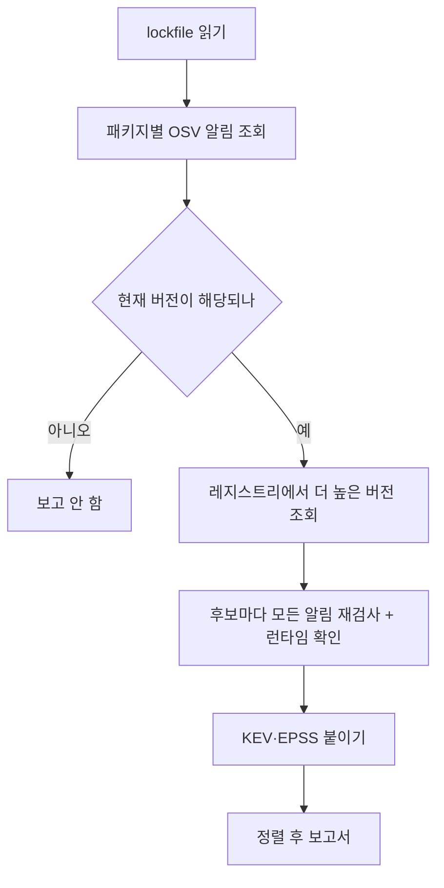

# fixplan

> **English summary** — fixplan turns vulnerability alerts into a fix plan: for each vulnerable package it computes the minimal upgrade that clears *every* known advisory, checks it against your PHP / Node / Python runtime, and ranks the work by CISA KEV and EPSS. It reads `composer.lock`, `package-lock.json`, `uv.lock` and `requirements.txt` (M1: Composer, PyPI, npm; Maven is planned for M2). Try it with no network: `npx github:LeeGyeongPil/fixplan scan <path> --offline` (practice data recorded 2026-11-10); live mode has not been verified end to end yet.

"알림이 떴는데, 그래서 어떤 버전으로 올리면 되지?"에 답해 주는 CLI입니다. 알림에 적힌 "고친 버전"만 따라 올리면 다른 알림이 남거나 런타임(PHP·Node·Python 버전)이 못 받는 경우가 있어서, 그 계산을 대신 해 줍니다.

## 결과 미리보기


*연습 데이터(`--offline`)로 예제 프로젝트를 검사한 결과. 위에서부터 먼저 고칠 순서입니다.*

> 예시는 모두 `--offline` 연습 데이터(2026-11-10 기록) 기준입니다. 지금의 실제 알림이 아닙니다. 실제 API를 부르는 라이브 모드는 구현·요청 형태 테스트까지만 했고, 개발 환경에서는 외부 호스트가 막혀 끝까지 실행해 보지 못했습니다. 처음 쓰시면 한 번 직접 돌려 보고 결과를 의심해 주세요.

## 이런 분께
- 의존성 알림이 수십 개 쌓여서 무엇부터 고칠지 정하기 어려운 분
- "고친 버전으로 올렸더니 다른 알림이 또 뜬다", "올리려니 PHP·Node 버전이 안 맞는다"를 겪는 분
- PHP(Composer)·Node(npm)·Python(PyPI)을 한 저장소나 한 모노레포에서 같이 쓰는 분

## 설치
```bash
# 전제: Node.js 24.10.0 이상 (예: https://nodejs.org 또는 nvm install 24), git
npx github:LeeGyeongPil/fixplan scan . --offline     # 설치 없이 실행
npm install -g github:LeeGyeongPil/fixplan           # 전역 설치(저장소에 빌드된 dist/ 가 들어 있어 빌드 단계가 필요 없음)
```
npm 레지스트리에는 아직 올리지 않았습니다. 소스에서 실행하려면:
```bash
git clone https://github.com/LeeGyeongPil/fixplan && cd fixplan && npm ci
node src/cli.ts scan examples/mixed-shop --offline
```
최소 리눅스 이미지에서는 `git`과 Node 24.10.0 이상만 있으면 됩니다. 실행 의존성은 `semver`, `@renovatebot/pep440`, `smol-toml` 세 개이고 API 키는 필요 없습니다.

## 빠르게 시작하기
```bash
npm start     # = node src/cli.ts scan examples/mixed-shop --offline
```
```
# fixplan report — examples/mixed-shop

> **offline snapshot recorded 2026-11-10 — practice data, not current advisories.** Practice mode (bundled data). Run without `--offline` for live results.

Scanned 3 lockfile(s), 7 package(s). Runtimes: php 8.1 (composer.json config.platform.php (estimated)) · node 18.0.0 (package.json engines.node lower bound (estimated)) · python 3.10 (pyproject.toml requires-python lower bound (estimated))

**Summary: 4 vulnerable package(s)** — fixable-in-major: 4 · major-upgrade: 0 · runtime-blocked: 0 · no-patch: 0 · in CISA KEV: 1

| # | Package | Current | Verdict | Minimal fix | Advisories | KEV | EPSS (max) | Command |
|---|---|---|---|---|---|---|---|---|
| 1 | npm systeminformation | 5.3.0 | fixable-in-major | 5.33.16 | 12 (CRITICAL) | yes | 90.67% | `npm install systeminformation@5.33.16` |
| 2 | npm lodash | 4.17.15 | fixable-in-major | 4.18.1 | 5 (HIGH) | no | 21.33% | `npm install lodash@4.18.1` |
| 3 | Packagist guzzlehttp/guzzle | 7.4.0 | fixable-in-major | 7.15.2 | 14 (HIGH) | no | 1.99% | `composer require "guzzlehttp/guzzle:^7.15.2"` |
| 4 | PyPI jinja2 | 3.1.2 | fixable-in-major | 3.1.6 | 5 (MODERATE) | no | 0.98% | `uv add "jinja2>=3.1.6"` |
```
(위 출력은 앞부분입니다. 뒤에 `## Details`로 패키지별 근거가 이어집니다.)

읽는 법:
- 표는 **KEV(실제 악용이 확인된 목록) → EPSS(앞으로 악용될 확률 추정치) → 심각도 → 조치 난이도** 순서입니다. 맨 위가 가장 급합니다.
- `Minimal fix`는 그 패키지의 **모든** 알림을 피하는 가장 낮은 버전, `Command`는 그 버전으로 올리는 명령입니다. fixplan은 명령을 제안만 하고 lockfile을 직접 고치지 않습니다.
- `Verdict`는 4가지입니다.

| 판정 | 뜻 |
|---|---|
| `fixable-in-major` | 지금 메이저 버전 안에서 해결됨 |
| `major-upgrade` | 메이저를 올려야 해결됨 |
| `runtime-blocked` | 고친 버전은 있지만 내 런타임이 못 받음(런타임을 먼저 올려야 함) |
| `no-patch` | 아직 고친 버전이 없음 (안전하다는 뜻이 아님) |

## 사용법
| 명령·옵션 | 하는 일 | 예 |
|---|---|---|
| `fixplan scan [path]` | 경로와 그 한 단계 아래 폴더의 lockfile을 찾아 검사 | `fixplan scan .` |
| `--offline` | 번들된 연습 데이터로 실행(네트워크 없음) | `--offline` |
| `--php` `--node` `--python <ver>` | 런타임 버전을 직접 지정(없으면 매니페스트에서 추정) | `--python 3.6` |
| `--format md\|json` | 출력 형식 (기본 md) | `--format json` |
| `--out <file>` | 보고서를 파일로 저장 | `--out plan.md` |
| `--fail-on kev,fixable,any` | 조건에 맞는 항목이 있으면 종료 코드 1 (CI용) | `--fail-on kev` |
| `--ignore <ID>` | 알림을 ID 또는 별칭(GHSA·CVE·PYSEC)으로 제외. 여러 번 쓰거나 쉼표로 구분 | `--ignore CVE-2021-21315` |
| `--verbose` | 진행 상황을 stderr로 | |
| `--snapshot <dir>` | 다른 스냅샷 폴더 사용(`--offline`과 함께) | |
| `--osv-url` `--kev-url` `--epss-url` | 데이터 주소 변경 | |

지원하는 입력: `composer.lock`(+`composer.json`), `package-lock.json` v2/v3, `uv.lock`, 버전이 고정된 `requirements.txt`.

### 시나리오 1. 알림 하나만 따라 올리면 왜 안 되나 (naive fix)
같은 패키지에 알림이 여러 개면, 가장 높은 "고친 버전"으로 올려도 다른 알림이 남을 수 있습니다.
```bash
node src/cli.ts scan examples/mixed-shop --offline | sed -n '38,44p'
```
```
### 2. lodash 4.17.15 (npm, direct, web/package-lock.json)

- verdict: **fixable-in-major** → minimal fix **4.18.1**
- runtime: node 18.0.0 — package.json engines.node lower bound (estimated)
- naive fix 4.18.0 (highest "fixed" among current advisories) is **still affected** by GHSA-f23m-r3pf-42rh
- command: `npm install lodash@4.18.1`
- advisories (5):
```

*알림이 가리키는 가장 높은 고친 버전(4.18.0)도 다른 알림(GHSA-f23m-r3pf-42rh)에 걸려서, 최소 버전은 4.18.1입니다.*

### 시나리오 2. 런타임이 못 받는 업그레이드
Python 3.6 환경이라고 가정해 봅니다.
```bash
node src/cli.ts scan examples/mixed-shop --offline --python 3.6 | grep -E 'jinja2 \||why:'
```
```
| 4 | PyPI jinja2 | 3.1.2 | runtime-blocked | 3.1.6 | 5 (MODERATE) | no | 0.98% | upgrade runtime first |
- why: 3.1.6 requires python >=3.7 (current 3.6); upgrade python to satisfy ">=3.7" to fix with 3.1.6
```

*3.1.6은 Python 3.7 이상을 요구하므로, 이 환경에서는 런타임을 먼저 올려야 합니다.*

`--php 7.2.0`이면 guzzle이, `--node 8`이면 systeminformation이 같은 이유로 막힙니다. `engines` 같은 필드가 해석되지 않으면 `unknown`으로 두고 막지 않고 메모만 남깁니다.

### 시나리오 3. CI에서 실패시키기
```bash
node src/cli.ts scan examples/mixed-shop --offline --fail-on kev > /dev/null; echo "mixed-shop exit=$?"
node src/cli.ts scan examples/clean --offline --fail-on any > /dev/null; echo "clean exit=$?"
```
```
mixed-shop exit=1
clean exit=0
```

*종료 코드: 0 정상 · 1 `--fail-on` 조건 일치 · 2 입력·네트워크 오류.*

잘못된 값은 2로 끝납니다. 예: `--fail-on nope` → `fixplan: unknown --fail-on value 'nope' (use kev, fixable, any)`, 없는 경로 → `fixplan: path not found or not a directory: nowhere`.

이미 검토해서 넘어가기로 한 알림은 `--ignore` 로 뺄 수 있습니다. 같은 알림의 별칭(CVE ↔ GHSA 등)도 함께 빠집니다.
```bash
node src/cli.ts scan examples/mixed-shop --offline --fail-on kev --ignore CVE-2021-21315 > /dev/null; echo "exit=$?"
```
```
exit=0
```
보고서 요약 줄 끝에 ` · ignored: 1` 이 붙고 `## Ignored` 절에 `- ignored: GHSA-2m8v-572m-ff2v (npm systeminformation 5.3.0, web/package-lock.json)` 처럼 남습니다. 주의할 점:
- 정확히 일치하는 ID만 제외합니다(대소문자 무시). 일부만 쓴 `GHSA-2m8v` 는 아무것도 빼지 않습니다. 경고는 stderr 가 아니라 보고서 끝 `## Warnings` 절(JSON 은 `warnings` 배열)에 `- --ignore GHSA-2m8v: matched no advisory in this scan` 으로 남고, `## Ignored` 절은 `- none (see warnings)` 가 됩니다. 경고 없이 효과도 없으면 `- none (no effect on the result)` 입니다.
- 만료일이 없습니다. 제외 목록은 직접 관리하세요.
- 제외한 알림은 계산에서 빠지므로 `minimal_fix` 가 낮아질 수 있습니다(그 알림이 요구하던 버전까지 올리지 않음). 현재 버전에는 해당하지 않고 후보 버전 검사에만 쓰이는 알림(예: lodash `GHSA-f23m-r3pf-42rh`)도 경고 없이 `## Ignored` 절에 `— affects candidate versions only` 로 남고 `ignored: N` 에 셉니다. 이 스냅샷에서 `GHSA-f23m-r3pf-42rh` 하나만 빼면 lodash 최소 버전은 4.18.1 그대로이고(4.18.0 은 레지스트리에서 deprecated 라 후보에서 빠집니다), `still_affected_by` 만 비게 됩니다. `--ignore GHSA-r5fr-rjxr-66jc,GHSA-f23m-r3pf-42rh` 처럼 함께 빼면 최소 버전이 4.17.23 으로 낮아집니다.
- 형식에 맞지 않는 값(`--ignore nope`)은 `fixplan: invalid --ignore id 'nope' (e.g. GHSA-xxxx-xxxx-xxxx, CVE-2021-21315)` 와 종료 코드 2.

### 시나리오 4. 기계가 읽는 JSON
`--format json`이면 항목마다 `verdict`, `minimal_fix`, `naive_fix`, `still_affected_by`, `command`, `runtime`이 들어 있습니다. `--ignore` 를 줬을 때만 최상위 `ignored` 배열(제외된 알림의 `id`·`aliases`·패키지·lockfile, 후보 버전에만 영향을 줬다면 `"affects": "candidate-versions-only"`)이 추가됩니다. CVE가 없는 알림의 EPSS는 `0`이 아니라 `"unknown"`입니다. 같은 입력이면 출력이 바이트 단위로 같습니다(시각 등 변하는 값 없음).

## 설정
- 설정 파일과 API 키는 없습니다.
- 환경변수: `FIXPLAN_OSV_URL`(기본 `https://api.osv.dev`), `FIXPLAN_KEV_URL`, `FIXPLAN_EPSS_URL`(기본 `https://api.first.org/data/v1/epss`).
- **연습용 목(mock) 모드(`--offline`)**: 2026-11-10에 공개 출처에서 받은 실제 응답을 예제 패키지(lodash·systeminformation·guzzle·jinja2)만 남기고 잘라 담은 스냅샷을 읽습니다. 고정된 출력을 찍는 게 아니라 라이브와 같은 계산 엔진이 이 데이터 위에서 돕니다. 다른 점: 이후 나온 알림이 없고, 스냅샷에 없는 패키지는 "not covered by the offline snapshot" 경고만 냅니다. 출처와 라이선스는 [snapshot/NOTICE.md](snapshot/NOTICE.md).
- `--offline` 에서 스냅샷에 없는 패키지는 `--fail-on` 판정에 들어가지 않습니다("확인 안 함"). 그래서 `--offline --fail-on` 의 종료 코드 0 은 "안전"이 아닙니다. CI 게이트에는 라이브 모드를 쓰세요. 리눅스·Node 24.10 에서의 동작은 CI 매트릭스로 확인합니다.
- **라이브 모드**: OSV, npm·PyPI·Packagist 레지스트리, CISA KEV, FIRST EPSS를 직접 부릅니다. 공개 API라 느릴 수 있어 요청당 제한 시간을 120초로 두었습니다. 코드 쪽 요청 형태는 테스트했고 npm·PyPI 레지스트리는 실제로 호출해 봤지만, 전체 흐름은 아직 실측하지 못했습니다.
- 프록시 뒤라면 Node의 `fetch`는 기본으로 `HTTPS_PROXY`를 쓰지 않으므로 `NODE_USE_ENV_PROXY=1`(Node 24+)을 함께 지정하세요.
- 런타임 추정 순서: 옵션 > `composer.json` `config.platform.php` > `require.php` 하한 > `package.json` `engines.node` 하한 > `pyproject.toml`/`uv.lock`의 `requires-python` 하한. 추정이면 보고서에 `(estimated)`가 붙습니다.

## 동작 원리

1. **lockfile 읽기** — 경로와 한 단계 아래 폴더에서 lockfile을 찾고, 옆의 매니페스트에서 런타임을 추정합니다.
2. **OSV 알림 조회** — 이름별로 한 번 조회하고, 같은 취약점의 여러 ID(GHSA·PYSEC)는 별칭으로 합칩니다. 철회된 알림은 무시합니다.
3. **해당 여부** — 알림의 범위 이벤트를 `[도입, 수정)` 구간으로 바꿔 현재 버전이 속하는지 봅니다. 버전 비교는 생태계별 문법(Composer, PEP 440, npm semver)으로 합니다.
4. **후보 검사** — 정식 릴리스만(프리릴리스·yank·deprecated 제외) 낮은 쪽부터 보며, 그 패키지의 모든 알림을 피하고 런타임이 받는 첫 버전을 고릅니다.
5. **KEV·EPSS** — 해당 알림이 있을 때만 조회해 순서를 정합니다.
6. **보고서** — Markdown 또는 JSON.

## 언제 쓰나
여러 알림을 한 번에 없애는 최소 버전과 런타임(PHP·Node·Python) 제약을 확인하거나, KEV·EPSS 순으로 무엇부터 고칠지 정할 때 fixplan을 씁니다. fixplan은 명령만 제안하며 PR 생성이나 lockfile 수정은 하지 않습니다.

자동 PR이 필요하면 [Dependabot](https://docs.github.com/en/code-security/dependabot)이나 [Renovate](https://docs.renovatebot.com/)를, 더 넓은 생태계 스캔이 필요하면 [osv-scanner](https://google.github.io/osv-scanner/)를, Python만 다루면 [pip-audit](https://github.com/pypa/pip-audit)를 살펴보세요.

## 지원 범위와 로드맵
**M1(0.1.0부터)**: Composer·PyPI·npm, 판정 4가지, naive fix 비교, 런타임 차단 설명, KEV·EPSS 정렬, Markdown·JSON, `--fail-on`.

**0.2.0**: `--ignore <ID>` — ID·별칭으로 알림 제외(CLI 전용, 사유·만료일 없음. 사유를 적는 `--waivers` 는 M2).

한계(정직하게):
- 명령은 제안일 뿐이고, 전이 의존성용 명령(`composer update --with`, npm `overrides`, `uv lock --upgrade-package`)은 실제 프로젝트에서 실행해 보지 않았습니다.
- 코드가 그 취약 함수를 실제로 부르는지(도달성)는 보지 않습니다.
- npm `engines`는 권고 필드이고, `unknown`은 안전하다는 뜻이 아닙니다. `no-patch`와 EPSS `unknown`도 같습니다.
- 스냅샷은 예제 패키지만 담고 있습니다. pnpm·yarn·poetry lockfile, Maven·Gradle은 아직 읽지 못합니다.
- OSV `/v1/query`를 패키지 이름만으로 부를 때 알림 전체가 오는지 문서에 명시가 없어서, 실패하면 `querybatch` + `/v1/vulns/{id}`로 대체하는 경로를 구현했지만 실서버에서는 확인하지 못했습니다(`--verbose`로 어느 경로인지 보입니다).

**M2(계획, 약속 아님)**: Maven·Gradle(`pom.xml`·`gradle.lockfile`), SARIF 2.1.0 출력, 코드 사용처 근거 줄(import·require), 예외 사유 초안(`--waivers`), 라이브 데이터로 스냅샷을 다시 기록하는 `fixplan snapshot record`.

## 자주 겪는 문제
| 증상 | 원인 | 해결 |
|---|---|---|
| `fixplan: network error: https://api.osv.dev/v1/querybatch (fetch failed)` 로 종료 코드 2 | 네트워크가 막혔거나 프록시 뒤 | 프록시 환경이면 `NODE_USE_ENV_PROXY=1`. 네트워크가 없으면 `--offline` |
| `not covered by the offline snapshot` 경고, 요약 아래 `N package(s) NOT checked` | 연습 스냅샷은 예제 패키지만 담음. 이 패키지들은 "안전"이 아니라 "확인 안 함"이며 `0 vulnerable` 에 포함되지 않음(JSON 은 `packages_unchecked`) | 라이브 모드로 실행 |
| 런타임이 `checked: false` | 매니페스트에서 런타임을 알 수 없음 | `--php`·`--node`·`--python` 지정 |
| `npm warn Unknown user config "python"` | 개인 npm 설정에 `python`이 있음(fixplan과 무관) | 무시하거나 `.npmrc`에서 제거 |
| `npm warn EBADENGINE` 경고(npm 은 기본으로 경고만 내고 계속 설치함), 또는 실행 오류 | Node가 24.10.0(`engines` 요구)보다 오래됨 | Node 24.10.0 이상으로 올리기 |

> 저장소에서 `examples/mixed-shop` 또는 `test/fixtures/lockfiles` 경로의 Dependabot 취약점 알림이 보이면: 연습용 입력이라 알려진 취약 버전을 일부러 고정한 것입니다(설치·배포되지 않음, [SECURITY.md](SECURITY.md) 참고). 알림은 "Vulnerable code is not actually used"(사용하지 않음) 사유로 닫고 버전은 올리지 마세요 — 예제 출력이 이 버전에 의존합니다.

## 개발·기여
```bash
npm ci
npm test            # 187 tests, 네트워크 없음
npm run typecheck
npm run compile      # src/ 를 고친 뒤 dist/ 를 다시 만듦(dist/ 는 저장소에 커밋됨)
```
버그·제안은 이슈로 남겨 주세요. 변경 기록은 [CHANGELOG.md](CHANGELOG.md).

## 더 알아보기
- OSV API: https://google.github.io/osv.dev/post-v1-querybatch/ (확인 2026-11-10)
- osv-scanner guided remediation: https://google.github.io/osv-scanner/experimental/guided-remediation/ (확인 2026-11-10)
- CISA KEV 카탈로그: https://www.cisa.gov/known-exploited-vulnerabilities-catalog (확인 2026-11-10)
- EPSS(FIRST): https://www.first.org/epss/ (확인 2026-11-10)
- Renovate `constraintsFiltering`: https://docs.renovatebot.com/configuration-options/#constraintsfiltering (확인 2026-11-10)

## 라이선스
MIT. 번들 스냅샷: GitHub advisory-database(CC-BY-4.0), CISA KEV 미러(CC0 1.0), EPSS는 FIRST 인용 요청에 따름. 자세한 내용은 [snapshot/NOTICE.md](snapshot/NOTICE.md).
